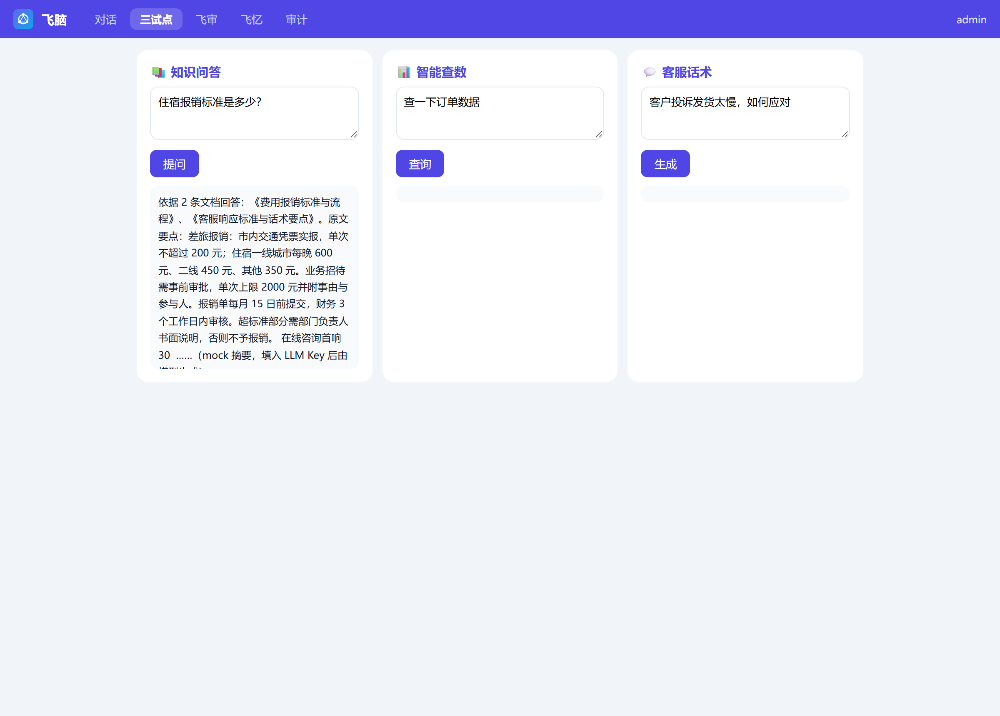
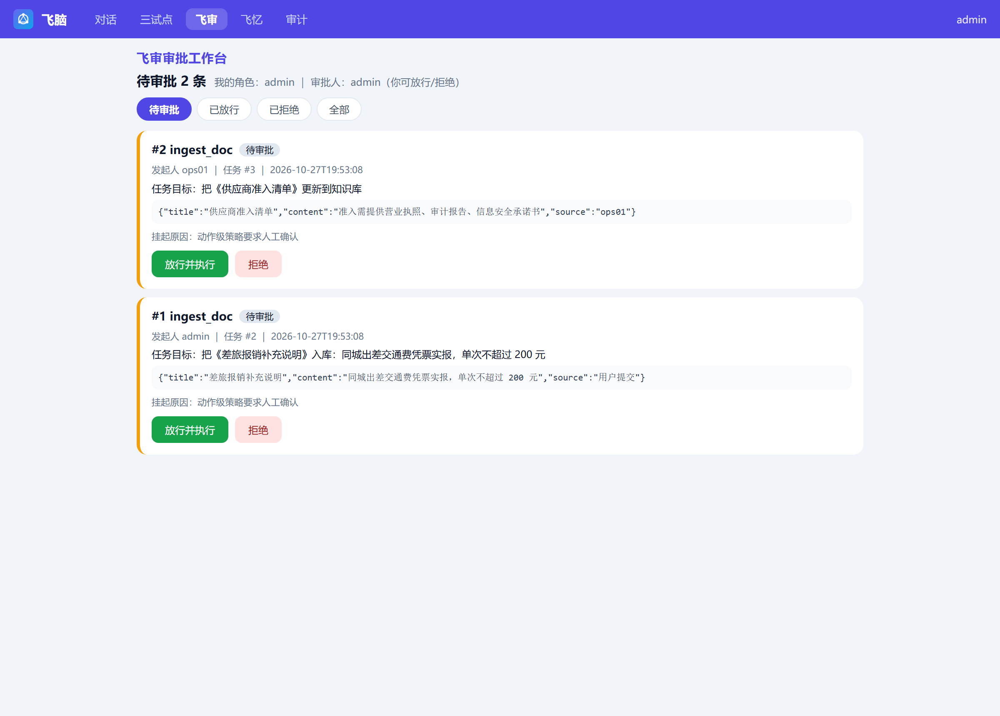

# FeiNao — an audit-first agent gateway

[](https://github.com/dukema81/feinao-agent/actions/workflows/ci.yml)
[](https://www.python.org/)
[](#5-zero-dependencies-is-a-design-constraint-not-a-shortcut)
[](LICENSE)

> Most agent demos show you what the model **said**.
> This one shows you what actually **happened** — and who **approved** it.

A self-contained Agent gateway in ~2,500 lines of Python: **standard library + SQLite only**.
No framework, no vector DB, no `pip install`. Clone it, run one command, and you get a working
agent with citations, an evidence log, per-action permissions, a human approval gate,
resumable task state, and cross-session memory.

```bash
git clone https://github.com/dukema81/feinao-agent.git && cd feinao-agent
python backend/server.py
# open http://127.0.0.1:8060/  →  admin / admin123
```

No API key needed: it falls back to a deterministic mock LLM and a built-in fake upstream, so
every screen works on first boot. Add a key to `.env` when you want real answers.
(中文说明见 [README.zh-CN.md](README.zh-CN.md))

<p align="center">
  
  <br><sub>Knowledge Q&A out of the box — demo data, mock LLM, citations included.</sub>
</p>
<p align="center">
  
  <br><sub>The approval workbench: a write action parked with its tool, arguments, requester and task goal. It runs only after someone clicks 放行并执行 (approve &amp; execute).</sub>
</p>

---

## The problem this repo addresses

Every team shipping an agent hits the same wall, and it is never the model:

| What breaks in production | What this repo does about it |
| --- | --- |
| "The agent said it saved the file." — it didn't. | `VERIFY_TAIL` forces every answer to state its basis; the `evidence` table records what the code observed, independent of the model's self-report. |
| "Who authorized that write?" | `tool_policies` declares roles / call budgets / `requires_confirm` per action. Write actions park in an approval queue and **do not execute** until a human approves. |
| "The run died at step 4, start over." | `tasks` + `task_steps` persist every tool call, denial and answer; resume with `task_id`. |
| "It forgot what we agreed on last week." | Cross-session memory extracts facts/decisions, defaults to **pending**, injects only after a human activates them. |
| "Context exploded after 100 turns." | LCM: full text in SQLite, summaries rolled up into a DAG, keyword retrieval back to the original passage. |

## What's actually different

**1. Evidence is code-recorded, not model-claimed.**
Every response writes an `evidence` row: which documents really matched, which tool calls really
ran, context size, whether the answer was flagged unverified. `GET /api/evidence` returns it.
You can diff that against what the model told the user.

**2. The approval gate is a real gate.**
This is the part most "human-in-the-loop" demos fake. When a write-class tool is requested:

```
model asks for ingest_doc
  → policy says requires_confirm
  → approval row created (tool, args, requester, task goal)
  → task status = waiting_approval, run returns
  → human POST /api/approvals/decide {decision:"approved"}
  → the action executes for real, then the task auto-continues
```

Reject it and the action never runs; the refusal reason is fed back to the model. Re-submitting
the same rejected action does not create a new ticket (anti-nagging), and approving twice replays
the cached result instead of writing twice (idempotent replay).

**3. Long context with receipts.**
LCM was measured, not asserted — see `docs/lcm-原型验证报告.md` and `tools/lcm_compare.py`:

| Scenario | Truncation | LCM |
| --- | --- | --- |
| 42 turns, recall an early fact | 0/8 | **8/8** |
| 161-token context budget | 0/8 (summary only) | **8/8** (summary + original-text retrieval) |
| 162 turns | 4,621 tokens | **1,283 tokens (−72%)** |

**4. Memory that asks first.**
Extraction runs three filters: grounding (every number must appear verbatim in the source),
process-noise rejection ("noted / synced / context" style chatter), and dedup with
new-value-supersedes-old. Candidates land in `pending`; nothing reaches the prompt until a human
clicks activate. `auto_activate_min` defaults to 1.0, i.e. off.

**5. Zero dependencies is a design constraint, not a shortcut.**
`git clone && python backend/server.py` works on a fresh machine with no network, which is what
makes this readable and auditable. You can read `ai.py` (1,000 lines) in one sitting and know
exactly what your agent is allowed to do. That is the whole point.

**6. "Better" is measured against a fixed task set, not against a feeling.**
Tuning a prompt or a budget and eyeballing three answers is how harnesses quietly rot. There is a
fixed 15-task benchmark (`bench/tasks.json`: RAG / NL2API / script / ReAct / approval), and one
command runs the same tasks on the current config and on a candidate:

```bash
python tools/bench.py --patch pilots.react_max_steps=8 --note "放宽步数上限"
```

```
任务           类型       通过率 base→cand  步数      工具调用   被拒    审批    证据
react-01       react      1.0 → 0.0        1.0→1.0  1.0→0.0   0.0→1.0  0.0→0.0  1.0→1.0
      ↳ 候选失败原因：没有执行预期动作 search_docs（实际：无）
汇总  通过率 1.0 → 0.0（差 -1）  证据完整率 1.0 → 1.0  被拒 0.0 → 1.0  审批交接 0.0 → 0.0
配置已还原：是（磁盘 spec.json 未被改动）
```

Every number is a fact read back from `task_steps` / `approvals` / `usage` / `evidence` — no model
grading itself. The pass/fail verdict comes from each task's `expect` block, so it is reproducible.
The candidate is stored as a revision with `active=0`: you benchmark it, then decide whether to
activate it. Config is swapped in memory only and restored afterwards, sha-verified.

**7. No score. A sentence you can check.**
The dual run ends with a comparison, not a grade: which tasks moved, in which direction, at what
cost, and whether the sample is even big enough to say so.

```
结论：先别上线：1 个任务稳定变坏（react-01），新的失败原因是「没有执行预期动作 search_docs（实际：无）」
建议：先别上线
  · 有效性：通过率 1 → 0.75。0 个任务稳定变好、1 个稳定变坏、0 个只差一次判不了、3 个逐条一致
  · 过程：被策略拒 1 个任务上升（0 → 1）
注意：这轮走的是 mock 上游（没有真实模型调用）：只说明链路与策略生效，不能当模型能力结论
```

A single flipped run is never called an improvement: with 3 runs per cell, only a gap of ≥2 runs (or
a unanimous flip) counts, everything else is reported as "cannot tell — need more runs". Open-ended
tasks have no ground truth, but two executions of the same task do have a difference, and that is
the only thing this layer is willing to assert. See `docs/对照式判定-上线说明.md`.

## Feature map

| Area | Endpoint | Notes |
| --- | --- | --- |
| Chat (LCM) | `POST /api/chat` | Server-side context assembly; client sends only text + `conv_id` |
| Knowledge Q&A | `POST /api/ai/ask` | FTS5 retrieval, answers carry `[DOC n]` citations |
| NL → data | `POST /api/ai/nl2api` | Entity matching from a spec, calls a REST API — never generates raw SQL |
| Support script | `POST /api/ai/script` | Five-section reply draft, grounded on the KB |
| ReAct agent | `POST /api/ai/react` | Tool registry, step budget, resumable by `task_id` |
| Approvals | `GET/POST /api/approvals[/decide]` | Execute-on-approve, TTL, idempotent replay |
| Memory | `GET /api/memory`, `POST /api/memory/{decide,extract}` | Pending-first, human activation |
| Evidence | `GET /api/evidence?conv_id=` | Code-recorded ground truth |
| Tasks | `GET /api/tasks[/detail]` | Step timeline including denials |
| Providers | `GET /api/providers/health?ping=1` | Never returns a full key — only `hasKey` / last-4 / length |
| Audit | `GET /api/audit` | Every tool + LLM call; `viewer` is denied |
| Config revisions | `GET /api/harness`, `POST /api/harness/{snapshot,activate}` | spec.json history, semantic diff, atomic rollback with hot reload (admin only) |
| Effective policy | `GET /api/ai/policy` | Modes, limits, egress whitelist, per-tool policy as currently enforced (secrets stripped) |
| Benchmark | `GET /api/bench`, `POST /api/bench/run` | Fixed 15-task set run twice (base vs candidate), metrics from real execution facts (admin only) |
| Verdict | `GET /api/bench/compare?a=&b=` | Plain-language conclusion instead of a score: what moved, at what cost, and whether the sample is enough (admin only) |

Roles out of the box: `admin` / `ops01` / `view01` (admin, ops, viewer).

## Architecture

```
                     ┌──────────────────────────────┐
  browser / PWA ────►│ engine.py  (HTTP, stdlib)    │
                     │  static + /api/* + roles     │
                     └───────┬──────────────┬───────┘
                             │              │
                    ┌────────▼───────┐  ┌───▼────────────────────┐
                    │ ai.py          │  │ lcm.py     memory.py   │
                    │ provider chain │  │ context    cross-session│
                    │ RAG / ReAct    │  │ DAG +      extract /   │
                    │ policy+approve │  │ retrieve   grounding   │
                    └────────┬───────┘  └───┬────────────────────┘
                             │              │
                     ┌───────▼──────────────▼───────┐
                     │      feinao.db (SQLite)      │
                     │ docs·evidence·tasks·steps    │
                     │ approvals·memory·audit·usage │
                     └──────────┬───────────────────┘
                                │ spec.json drives providers,
                                │ policies, roles, upstreams
                     ┌──────────▼───────────────────┐
                     │ upstreams: KMS · BI · tickets │
                     │ demo mode substitutes a       │
                     │ built-in fake on :8099        │
                     └───────────────────────────────┘
```

## Demo mode vs. real upstreams

By default `FEINAO_DEMO=1`, which:

- serves a deterministic fake upstream on `:8099` (login / spec / rows — same contract as the real thing)
- seeds 9 knowledge documents so RAG has something to cite
- says so in the startup banner

Point it at your own systems with `FEINAO_DEMO=0` plus:

```bash
FEINAO_UPSTREAM_KMS=http://your-kms:8050/kms/
FEINAO_UPSTREAM_BI=http://your-bi:8041/bi/
FEINAO_UPSTREAM_CC=http://your-desk:8043/cc/
```

An upstream only needs three endpoints:

```
POST api/login   {username,password} → {token}
GET  api/spec    → {entities:[{key,label,desc}]}
GET  api/<entity>?limit=20&q=keyword → {rows:[...], total:N}
```

## Acceptance runs on a copy, on :8081

`feinao-test/` holds a test spec and a scrubbed copy of the database. Three switches
(`FEINAO_SPEC`, `FEINAO_DB`, `FEINAO_PORT`) are pinned by a tool, so nobody has to remember them:

```bash
python tools/testenv.py --prep       # build the scrubbed DB copy (seeded fake data if there is no source)
python tools/testenv.py --serve      # boot on :8081
python tools/testenv.py --check      # smoke: health / login / RAG / ReAct / policy / benchmark
python tools/testenv.py --preflight  # port probe: open / rst / timeout / refused are four different things
```

The guards are refusals, not warnings. Point `FEINAO_SPEC` at `backend/spec.json`, point `FEINAO_DB` at
`backend/feinao.db`, set `FEINAO_DEMO=0`, or pick a port outside 8080-8099 and it will not start.
It also blanks any LLM keys present in your shell for that process, because a test that silently hits
a real model is not expensive — it is unreproducible: the same case passes today and fails tomorrow
and you cannot tell whether the code or the model changed.

A test asserts the test spec stays isomorphic to the production spec (only port, upstream URLs,
display names and passwords may differ). Loosening `modes` / `limits` / `tool_policies` to make
acceptance go green will turn that test red.

## Tests

```bash
python -m pytest tests/ -q      # 90 passed
```

Covers the full HTTP chain (real server, mock LLM), LCM recall, the approval lifecycle, memory
extraction and grounding, the demo upstream contract, config versioning (semantic diff, atomic
rollback, dirty-JSON rejection), the three loop circuit breakers, the benchmark dual run, and the
comparison rules (a single flip is never called an improvement), and the local test-env guards
(including a test that a deliberately broken candidate scores lower). CI runs it on Python
3.9 / 3.11 / 3.13, plus a clone-and-run smoke test that installs **nothing**.

## Read before deploying

This is a reference implementation, not a hardened product. At minimum:

1. Change the factory passwords — the server prints `[warn] default password in use` if you don't.
2. Don't expose `:8060` directly; put TLS and access control in front of it.
3. Set `FEINAO_DEMO=0`, otherwise your real upstreams are never called.

Details and known trade-offs: [SECURITY.md](SECURITY.md).

## Docs

- [docs/建设方案.md](docs/建设方案.md) — design and scope
- [docs/lcm-原型验证报告.md](docs/lcm-原型验证报告.md) — the LCM experiment, with numbers
- [docs/证据链-权限预算-任务状态-上线说明.md](docs/证据链-权限预算-任务状态-上线说明.md)
- [docs/飞审审批工作台-上线说明.md](docs/飞审审批工作台-上线说明.md) — the approval gate
- [docs/飞忆跨会话记忆-上线说明.md](docs/飞忆跨会话记忆-上线说明.md) — cross-session memory
- [docs/Harness2-对照与差距清单.md](docs/Harness2-对照与差距清单.md) — how this repo maps onto Google's Harness² eight editable components, and what's still missing
- [docs/Harness版本化-上线说明.md](docs/Harness版本化-上线说明.md) — config versioning: snapshot / semantic diff / one-click rollback
- [docs/策略数据化与卡死上限-上线说明.md](docs/策略数据化与卡死上限-上线说明.md) — policy moved into spec.json + three loop circuit breakers
- [docs/基准任务集与双跑对照-上线说明.md](docs/基准任务集与双跑对照-上线说明.md) — the fixed task set and how a config change is judged
- [docs/对照式判定-上线说明.md](docs/对照式判定-上线说明.md) — why there is no score, and how a difference becomes a sentence
- [docs/本地测试环境与端口体检-上线说明.md](docs/本地测试环境与端口体检-上线说明.md) — the test env on :8081, and why an SSH port that resets is not a port that is closed

## Contributing

Small, focused changes with tests are very welcome — see [CONTRIBUTING.md](CONTRIBUTING.md).
One rule: new behavior needs a test that proves it, because the whole point of this repo is that
"it works" should be checkable.

MIT licensed.
